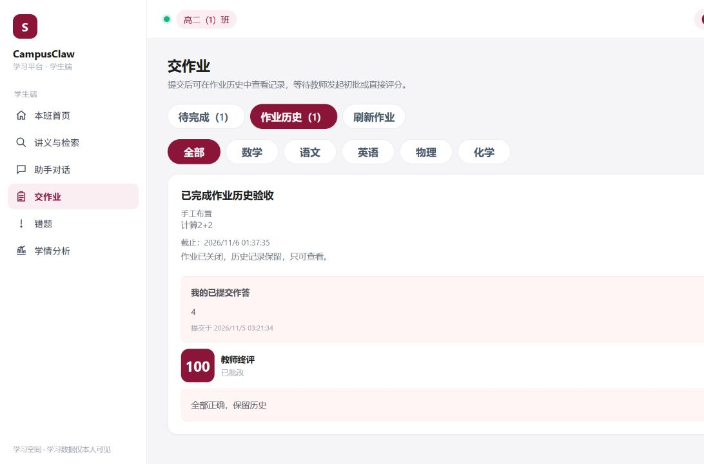

# 批改计数、作业历史与错题同步

日期：2026-11-04。已更新本机 `http://localhost:8083` 的 campusclaw-groupv3，其他三套部署未更新。刷新浏览器后生效。

## 这次改了什么

1. 教师进度显示“批改尝试1次（本轮上限3次）”。消息累计43次保留为审计，不能当成模型批改43次。已确认的排队消息不会再因每30秒扫描而重复发布；未确认失败和执行中断仍能恢复。
2. 学生“交作业”分为“待完成”和“作业历史”。提交后进入历史，保留题目、最新答案、提交时间、教师分数和评语；刷新、筛选学科、老师关闭后仍可看。关闭或逾期不能重交。沿用截止前重交覆盖最新答案的现有规则，没有新增每次重交版本库。
3. 保持原来整份作业低于60分才自动收录错题的规则。教师改到60–100分，同一事务清理对应旧错题；AI建议分不决定收录。100分作业因此不会留在错题本。

## 你自己怎么核对

使用自己的账号，不需要改数据库或调用模型：

1. 学生登录，进入“交作业”，提交一份未截止作业；查看“作业历史”，确认刚才的答案和提交时间。刷新后再点“作业历史”，记录仍在。
2. 教师对该提交打100分、写评语。学生刷新历史，应看到100分和评语；“错题”中不应出现它。老师关闭作业后，历史仍在且不能再提交。
3. 若要测改分边界，另建测试作业：老师先打59分，错题出现；再改100分，对应错题消失。这个检查会实际改成绩，请只用专门测试作业。
4. 教师“查看提交”核对进度。已有消息43次、执行1次的任务，页面应显示“批改尝试1次”，不是43次。

页面验收使用隔离数据库与合成账号，未给真实学生改分。下图为合成验收页面：



[历史页面文字](async-grading/history-student-closed.txt)、[刷新后记录](async-grading/history-student-reloaded.txt)、[满分后错题为空](async-grading/history-student-no-mistakes.txt)、[教师计数](async-grading/history-teacher-count.txt)。

## 自动复现与结果

在仓库根目录执行完整检查：

```powershell
backend\.venv\Scripts\python.exe scripts\check.py
```

本次26组全部通过，见[完整输出](async-grading/history-full-check.txt)。其中异步57项、历史与错题33项、前端边界6项：[异步结果](async-grading/history-async-check.json)、[历史结果](async-grading/history-business-check.json)、[前端结果](async-grading/history-ui-check.json)。首次检查曾发现修复脚本导入错误，修正实现后重新全量通过，没有删断言；[首次失败](async-grading/history-first-gate.txt)保留。

真实消息队列单独复现（需要Docker，使用空临时库和本地假模型）：

```powershell
backend\.venv\Scripts\python.exe scripts\reproduce_async_grading.py --output-prefix history-
```

脚本隔离创建并清理自己的容器，不操作8083教学数据。14项通过：[真实队列结果](async-grading/history-real-broker-result.json)、[消费者事件](async-grading/history-worker-events.json)。暂停消费者32秒，队列从20条保持20条；还覆盖停止重启、执行时杀进程、代理重建、重复消息、死信及人工重试。命令会覆盖同前缀证据，要保留本次记录可换一个前缀。

另外在源码隔离副本故意恢复旧重复投递、关闭及格错题清理，两项对应检查都失败；工作区源码未改变。见[故意改坏记录](async-grading/history-red-green.json)。

## 旧数据修复与备份

更新前停止本组后台写入并备份数据库及上传文件到本机忽略目录 `.review/history-predeploy-20261104-212300/`。限定清理先dry-run，再apply，再重复apply，依次匹配1条、删除1条、删除0条；只删除已被教师评分及格、关联本人/班级/学科/作业均匹配的派生错题。

[预览](async-grading/history-cleanup-dry-run.json)、[执行](async-grading/history-cleanup-apply.json)、[重复执行](async-grading/history-cleanup-again.json)、[部署核对](async-grading/history-deployment.json)。其他34张表与31个上传文件指纹未变，数据库完整性正常；账号、作业、答案、成绩及消息43/执行1的审计均保留。备份包含私人数据，不进入Git。需恢复时必须先停止本组写入、核对备份路径和时间，不能边运行边覆盖数据库。

修复工具默认只预览：`backend\.venv\Scripts\python.exe scripts\repair_resolved_mistakes.py --database <明确的现有数据库路径>`；`--apply` 会先创建SQLite备份再清理。平时不用反复运行，正常教师改分会自动同步。

## 验证边界

测试使用假模型，真实的是RabbitMQ，不证明真实AI的评分准确率、费用或外网耗时。没有改变提示词、账号、数据库表结构、逐题评分能力或原来的低于60分规则。未执行另一成员/另一机器复验、人工交叉评审、正式提交、版本标签或OpenSpec归档；tasks勾选保留，实际验收写在[变更验证记录](../openspec/changes/2026-11-04-refine-grading-and-assignment-history/validation.md)。
