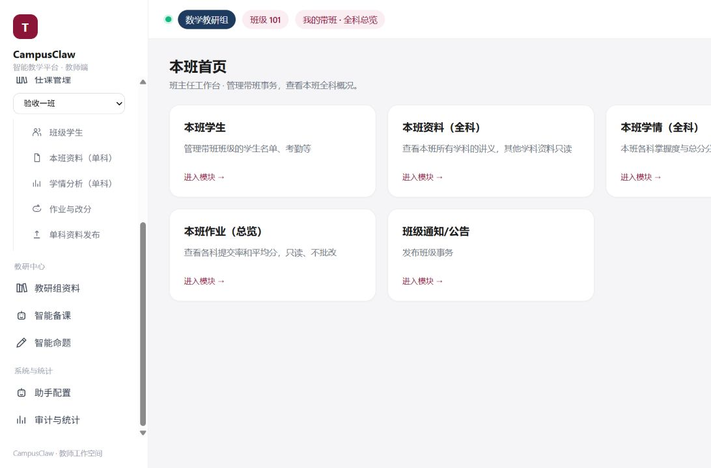

# 移除教研问答与课例分析

2026-11-04。两项原来只有共用菜单及占位，没有独立后端接口或存储；本次移除入口和对应占位访问，旧view链接进入智能备课。

教研中心保留顺序：教研组资料 → 智能备课 → 智能命题。教师工作区、资料、上传、备课、命题页面使用同一导航。没有修改后端、账号、教学数据或评分逻辑。

## 自己怎么验证

1. 打开8083，按Ctrl+F5刷新，查看教师侧栏“教研中心”，应只有上述三项。
2. 点击资料、备课、命题，每个页面都不应出现教研问答或课例分析。
3. 在已登录的教师标签页访问 `/teacher?workspace=teaching&view=research-qa` 或 `view=case-analysis`，应进入 `/teacher/lesson-prep`。
4. 打开“作业与改分”、学生端作业历史，原功能继续使用。

## 已运行证据

- [导航35项结果](navigation-result.json)：班主任/普通任课、有/无班级、6个共用页面、2个旧view和其他参数/菜单/切班。
- [旧实现失败](navigation-red.txt)：旧菜单实际5项，期望3项，检查失败；[修正后通过](navigation-green.txt)。没有删除或放宽断言。
- [全量门禁](full-check.txt)：27组PASS，含既有角色守卫、全部作业/异步/历史检查；[本次摘要](verification.json)。全部离线、临时库/假模型，不调用真实AI。
- 独立3009/8009、合成教师页面实际验收：[教师首页](teacher-home.txt)、[旧问答链接](legacy-research-qa.txt)、[旧课例链接](legacy-case-analysis.txt)。没有在真实教学数据库添加测试账号。
- [更新与健康核对](deployment.json)、[旧前端镜像](previous-frontend-image.txt)。只更新campusclaw-groupv3前端并刷新其nginx，其他部署不动；没有演练回退，不将旧镜像编号等同于回滚测试通过。

规约和设计见[本次变更](../../openspec/changes/2026-11-04-remove-unused-research-pages/proposal.md)。未执行OpenSpec归档、未修改tasks勾选、未提交/打标签。另一成员交叉评审仍待执行。
